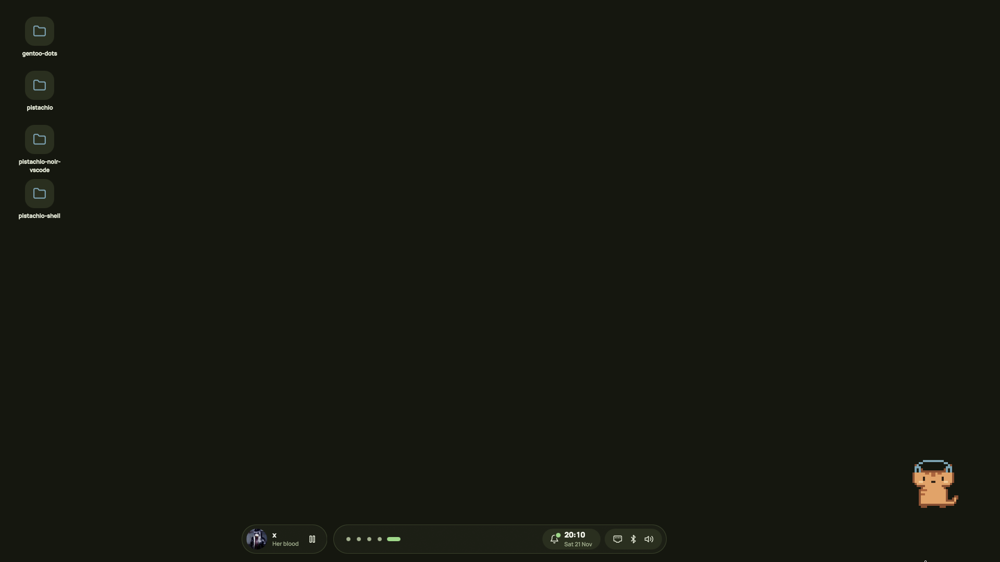
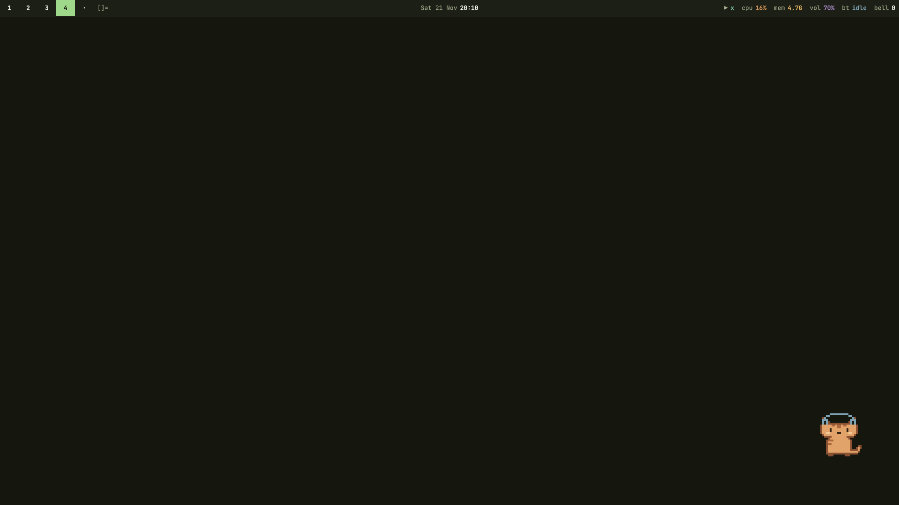

<div align="center">
  

  # Pistachio Noir Shell

  **A desktop shell, in both senses of the word.**

  A Hyprland shell written in QML on Quickshell, roasted in the soft greens and near-blacks of Pistachio Noir. Lightly salted, never burnt.

  
  
  
  
  
  

  [Features](#features) · [Getting started](#getting-started) · [The launcher](#the-launcher) · [Good to know](#good-to-know) · [Development](#development)
</div>

---

Pistachio Noir Shell is everything around your windows: the bar, the launcher, notifications, quick settings, the lock screen and a Settings window, plus a few things nobody asked for but everybody pets (there is a cat). It runs on Hyprland through [Quickshell](https://quickshell.org), with a handful of small Rust helpers doing the heavy lifting in the background, so the QML can stay calm and pretty.

It is made for one person's desk first: a single monitor, a wired connection and a keyboard that gets used a lot. If that sounds like yours, pull up a chair.

<table>
<tr>
<td width="50%" align="center">
  
  <br>
  <sub><b>Classic</b>: soft pills at the bottom, folders on the desktop, a cat with good taste in music.</sub>
</td>
<td width="50%" align="center">
  
  <br>
  <sub><b>TUI</b>: one square strip along the top. Same cat. Same headphones.</sub>
</td>
</tr>
</table>

## Features

<table>
<tr>
<td width="50%" valign="top">

**The bar and its friends**

- A floating pill at the bottom with workspaces, the window title, the clock and an Ethernet, Bluetooth and volume chip.
- Media and tray pills beside it; it all tucks itself away when a window needs the room.
- An Overview of every workspace, and an Alt+Tab switcher.

</td>
<td width="50%" valign="top">

**A launcher that does a bit too much (on purpose)**

- Apps, windows, workspaces, system controls and Bluetooth devices, with fuzzy search that forgives accents.
- Prefixes for commands, files, emoji, notifications, the web, clipboard history and maths.
- Background jobs, pins and aliases, project folders and games.

</td>
</tr>
<tr>
<td width="50%" valign="top">

**Notifications that know their place**

- Toasts, a notification centre grouped by app, and a month calendar with your GNOME Calendar events.
- Do not disturb with schedules, per-app rules, and quiet modes for fullscreen and calls.

</td>
<td width="50%" valign="top">

**Settings without the scavenger hunt**

- Quick settings for sound, brightness (DDC/CI), night light and Bluetooth.
- A Settings window with search and page resets, plus export and import to one TOML file.
- A first-run setup that checks what's installed before you need it.

</td>
</tr>
<tr>
<td width="50%" valign="top">

**Capture and ask**

- Screenshots of a region, a window or the screen; recording with a countdown, pause and trim.
- **Lens**: snip part of the screen and ask Claude or ChatGPT about it (through their own CLIs, read-only).
- A small **Quick chat** above the bar for the questions that can't wait.

</td>
<td width="50%" valign="top">

**Focus, Zen and a cat**

- Zen mode hides everything but your work; Focus and Pomodoro sessions hold back the noise.
- Desktop widgets and an ambient clock for empty desktops.
- A pixel desktop cat in three coats. He purrs if you pet him. He also judges your tiling.

</td>
</tr>
<tr>
<td width="50%" valign="top">

**Two looks**

- **Classic**: soft pills, rounded panels and gentle shadows.
- **TUI**: a square, monospaced terminal look with a strip along the top, for when you want your desktop to feel like `htop` dressed up for dinner.
- Pistachio Noir or **Noir**, a neutral grey scheme, switched live.

</td>
<td width="50%" valign="top">

**Plays well with others**

- Kitty, Neovim and VS Code follow the shell's colours; an app with a theme of your own is asked about first.
- The polkit agent, Bluetooth pairing, USB drive mounting and LocalSend, all built in.
- Power menu with suspend, reboot and **Restart into…** your other Limine boot entries; works with systemd and with OpenRC (elogind).

</td>
</tr>
</table>

Every feature, key and setting is listed in the [full feature reference](docs/README.LLM.md). It is long. It is thorough. It was written for the AI agents that helped build the shell, and it shows.

## Getting started

### Requirements

- **Hyprland** (Lua or classic config) and **Quickshell 0.3.2**, on Qt 6.
- **Rust** (`cargo`) to build `psc` and the helpers.
- **PipeWire** with WirePlumber, **NetworkManager**, **BlueZ** and **wl-clipboard** for the everyday bits.
- Optional, each lighting up its own corner: `ddcutil` (brightness), `hyprsunset` (night light), `grim`/`slurp`/`gpu-screen-recorder` (capture), `qalc` (maths), the Claude Code or Codex CLI (Lens and Quick chat), GNOME Calendar (events), and more.

Tested on Arch Linux and on Gentoo with OpenRC. [Requirements](docs/requirements.md) has the whole list, with package names for both, and `psc doctor` checks your machine against it.

### Install

```sh
git clone https://github.com/pistachio-noir/pistachio-shell.git ~/projects/pistachio-shell
cd ~/projects/pistachio-shell
./install.sh
```

`install.sh` links the shell into `~/.config/quickshell/pistachio`, builds and installs `psc` and the helpers into `~/.local/bin`, installs the Manrope font and finishes with a check that prints the exact `pacman` or `emerge` line for anything missing. It never installs packages by itself. `./install.sh dry` shows what it would do.

Stop any other notification daemon (`mako`, `dunst`, `swaync`) and any other bar first, then try it from a terminal inside Hyprland:

```sh
psc        # runs the shell in this terminal; psc start runs it in the background
```

The first start opens a short setup. To start the shell with Hyprland, add `qs -c pistachio` to your autostart. [Installation](docs/install.md) covers both config styles, updating and the keybinds.

### Which branch?

| Branch | What it is |
|:--|:--|
| `main` | **Stable.** What a fresh clone gives you, and what you probably want. |
| `experimental` | **Where the work happens.** New features land here first, still warm from the oven |

To live on the edge:

```sh
git switch experimental && ./install.sh && psc restart
```

### psc, the remote control

`psc` starts, stops and talks to the shell, from a terminal or a keybind:

| Command | What it does |
|:--|:--|
| `psc start` / `psc restart` / `psc stop` | Run, restart or stop the shell |
| `psc launcher toggle` | Open or close the launcher |
| `psc doctor` | What the shell needs, found or missing, with the package to install |
| `psc status` | Is it running, for how long and how much memory |
| `psc log --errors` | Only the lines that went wrong |
| `psc ipc` | Every command the shell answers to |

[psc, IPC and keybinds](docs/ipc-and-keybinds.md) lists them all, with ready-made Hyprland binds.

## The launcher

Type to search apps. Start with a prefix to do something else:

| Type | To |
|:--|:--|
| `$btop` | Run a command in your terminal (<kbd>Shift</kbd> + <kbd>Enter</kbd> runs it in the background) |
| `/invoice` | Find files and folders in your home |
| `:fire` | Copy an emoji 🔥 |
| `;` | Search what you copied lately, and copy it again (turn on Clipboard history first) |
| `!word` | Find an old notification |
| `@hyprland rules` | Search the web |
| `12*(3+4)` or `= 30 EUR to PLN` | Do maths, units and currencies |
| `ask how do I…` | Ask the quick chat |
| `timer 5m tea` · `alarm 7:30` · `stopwatch start` | Keep time |
| `kill firefox` | End a process (asks first) |
| `?` | The cheat sheet, with your own Hyprland binds |

Arrows or <kbd>Ctrl</kbd> + <kbd>H</kbd> <kbd>J</kbd> <kbd>K</kbd> <kbd>L</kbd> move around. There is also a cheat code. You know the one.

## Good to know

- **Hyprland only.** The shell talks to Hyprland through one small adapter and assumes it's there.
- **One monitor, wired network.** No battery widget, no Wi-Fi menu: it was built for a desktop PC on a cable. Other setups may work, but nobody has checked.
- **No systemd required.** Power actions go to logind over D-Bus, so elogind on OpenRC works too.
- **Opinionated by design.** Pistachio marks what's active, and very little else is green. The colours come from one file.
- **Experimental corner.** Game mode, the ambient clock and dev features live under Settings → Experimental, off until you say otherwise.

Something misbehaving? [Troubleshooting](docs/troubleshooting.md) has the usual suspects, and `psc log --errors` usually has the confession.

## Documentation

- [Full feature reference](docs/README.LLM.md): every feature, key and setting.
- [Requirements](docs/requirements.md) and [installation](docs/install.md).
- [psc, IPC commands and Hyprland keybinds](docs/ipc-and-keybinds.md).
- [Frosted panels](docs/frosted-panels.md), [lock screen](docs/lock-screen.md) and [login screen](docs/login-screen.md) (an SDDM theme to match).
- [Theming and colours](docs/theming.md): how Kitty, Neovim, VS Code and Hyprland's borders follow along.
- [Troubleshooting](docs/troubleshooting.md) and the [repository layout](docs/repository-layout.md).

## Development

```sh
sh tests/run.sh             # every suite that's safe on a running desktop
sh tests/run.sh --native    # also the ones that open windows for a moment
cd rust && cargo test --workspace
```

Quickshell reloads on save, so most changes show up while you type. `tests/README.md` says what each suite covers; the ones that touch real devices are kept apart and never run by `tests/run.sh`.

| Path | Purpose |
|:--|:--|
| [`src/`](src/) | The shell: bar, panels, popups, launcher, settings, lock screen, components and services |
| [`rust/`](rust/) | `psc` and the helpers: polkit agent, Bluetooth pairing and drives, LocalSend |
| [`integrations/`](integrations/) | What the shell sets up elsewhere: Kitty, Neovim, VS Code, the SDDM theme, hypridle |
| [`tests/`](tests/) | Isolated suites with stand-ins, plus the few live ones |
| [`docs/`](docs/) | Meant for AI Agents, Guides, the full feature reference, and how it was built (`plan.md`, `decisions.md`, `gotchas.md`) |

## License

Pistachio Noir Shell is licensed under the [GNU General Public License v3.0](LICENSE) (GPL-3.0-only).

### Third-party notices

The icon paths in [`src/components/Icons.qml`](src/components/Icons.qml) include icons from [Lucide](https://lucide.dev/). Some Lucide icons are derived from [Feather](https://feathericons.com/). The applicable notices are reproduced below; see the [upstream license](https://github.com/lucide-icons/lucide/blob/main/LICENSE) for the list of Feather-derived icons.

<details>
<summary>Lucide — ISC License</summary>

```text
ISC License

Copyright (c) 2026 Lucide Icons and Contributors

Permission to use, copy, modify, and/or distribute this software for any
purpose with or without fee is hereby granted, provided that the above
copyright notice and this permission notice appear in all copies.
THE SOFTWARE IS PROVIDED "AS IS" AND THE AUTHOR DISCLAIMS ALL WARRANTIES
WITH REGARD TO THIS SOFTWARE INCLUDING ALL IMPLIED WARRANTIES OF
MERCHANTABILITY AND FITNESS. IN NO EVENT SHALL THE AUTHOR BE LIABLE FOR
ANY SPECIAL, DIRECT, INDIRECT, OR CONSEQUENTIAL DAMAGES OR ANY DAMAGES
WHATSOEVER RESULTING FROM LOSS OF USE, DATA OR PROFITS, WHETHER IN AN
ACTION OF CONTRACT, NEGLIGENCE OR OTHER TORTIOUS ACTION, ARISING OUT OF
OR IN CONNECTION WITH THE USE OR PERFORMANCE OF THIS SOFTWARE.
```

</details>

<details>
<summary>Feather-derived icons — MIT License</summary>

```text
The MIT License (MIT) (for the icons listed in Lucide's upstream license)

Copyright (c) 2013-present Cole Bemis
Permission is hereby granted, free of charge, to any person obtaining a copy
of this software and associated documentation files (the "Software"), to deal
in the Software without restriction, including without limitation the rights
to use, copy, modify, merge, publish, distribute, sublicense, and/or sell
copies of the Software, and to permit persons to whom the Software is
furnished to do so, subject to the following conditions:
The above copyright notice and this permission notice shall be included in all
copies or substantial portions of the Software.
THE SOFTWARE IS PROVIDED "AS IS", WITHOUT WARRANTY OF ANY KIND, EXPRESS OR
IMPLIED, INCLUDING BUT NOT LIMITED TO THE WARRANTIES OF MERCHANTABILITY,
FITNESS FOR A PARTICULAR PURPOSE AND NONINFRINGEMENT. IN NO EVENT SHALL THE
AUTHORS OR COPYRIGHT HOLDERS BE LIABLE FOR ANY CLAIM, DAMAGES OR OTHER
LIABILITY, WHETHER IN AN ACTION OF CONTRACT, TORT OR OTHERWISE, ARISING FROM,
OUT OF OR IN CONNECTION WITH THE SOFTWARE OR THE USE OR OTHER DEALINGS IN THE
SOFTWARE.
```

</details>

---

<sub>This project was written with assistance from Claude and Codex. No pistachios were harmed; several were eaten.</sub>
